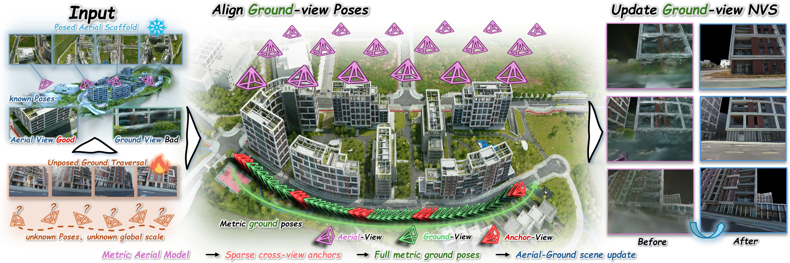
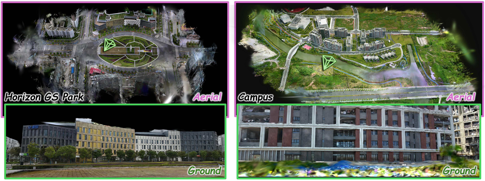

# SkyAnchor: Updating Metric-scale Aerial 3D Gaussian Scenes from Unposed Ground-View Sequences

**SIGGRAPH Asia 2026** · [Paper (arXiv)](https://arxiv.org/abs/2609.13903) · [PDF](https://arxiv.org/pdf/2609.13903)

**Preview version.** This repository provides an early release of SkyAnchor, organized into three components: aerial–ground anchor registration (`agRecon`), ground pose reconstruction (`anchorRecon`), and Gaussian Splatting (`splatting`). The preview includes the updates described below; further reconstruction speed improvements are planned for the final release.

SkyAnchor connects aerial and ground imagery through anchor poses, reconstructs a ground image sequence in the aerial reference frame, and trains a joint aerial–ground 3D Gaussian Splatting model.

The pipeline has three modules:

| Module | Purpose | Entry point |
| --- | --- | --- |
| `agRecon` | Register ground anchor frames against an existing aerial COLMAP reconstruction. | `reconstruct_ag.py` |
| `anchorRecon` | Estimate the remaining ground poses, refine submaps with bundle adjustment, and export a COLMAP model. Includes an interactive anchor-pose viewer. | `train.py` |
| `splatting` | Prepare training images, remove sky, select matching pairs, and train aerial, ground, and joint Gaussian stages. | `train.py` |

The root entry point, `run_skyanchor.sh`, runs all three modules and handles the intermediate data conversion.

## Changes

### 1. LoMa for ground pose estimation

The updated ground pose reconstruction pipeline uses **LoMa** for image matching. On the **Campus** scene, the updated pipeline achieves the following pose-estimation results compared with those reported in the paper. Lower is better for all metrics.

| Version | ATE (m) ↓ | RPE-t (m) ↓ | RPE-r (°) ↓ |
| --- | ---: | ---: | ---: |
| Paper | 1.404 | 0.598 | 0.457 |
| Preview with LoMa | **0.437** | **0.100** | **0.395** |

ATE denotes absolute trajectory error; RPE-t and RPE-r denote the translational and rotational components of relative pose error, respectively.

### 2. Dense point-cloud initialization with stable pair selection and SOR filtering

LoMa provides sparse correspondences for ground pose estimation rather than the dense correspondences used by RoMa in the paper. Consequently, the updated pose pipeline does not directly produce the same dense, bundle-adjusted point cloud for Gaussian initialization.

Inspired by [EDGS: Eliminating Densification for Efficient Convergence of 3DGS](https://compvis.github.io/EDGS/) ([official code](https://github.com/CompVis/EDGS)), we construct the dense initialization separately by triangulating RoMaV2 correspondences using the reconstructed camera poses. To improve triangulation stability, we first select image pairs using **shared 3D observations and triangulation angles**, as implemented in [`splatting/selectpairs.py`](splatting/selectpairs.py). Candidate pairs must observe common COLMAP points and have a 75th-percentile triangulation angle of at least **1°**. We rank eligible pairs by the number of shared points with valid viewing rays and retain up to **five neighboring views per image** by default. This favors image overlap while rejecting pairs with insufficient parallax.

After triangulation, we additionally apply **Statistical Outlier Removal (SOR)** to reduce isolated outliers and obtain a cleaner initial point cloud for Gaussian Splatting.

## TODO

For the final release, we plan to improve reconstruction speed in two areas:

- [ ] **Share aerial-view selection within each anchor group.** Optimize `agRecon` so that the six ground images in an anchor group reuse the same selected aerial views, instead of selecting aerial views independently for every ground image. Viewpoint changes within an anchor group are small, making this a promising way to reduce repeated retrieval and selection work.
- [ ] **Use BAE for ground bundle adjustment.** Integrate BAE as the ground BA component to accelerate ground pose reconstruction.

## Contents

- [Changes](#changes)
- [TODO](#todo)
- [Installation](#installation)
- [Data preparation](#data-preparation)
- [Run the complete pipeline](#run-the-complete-pipeline)
- [Reuse intermediate results](#reuse-intermediate-results)
- [Run individual modules](#run-individual-modules)
- [Outputs](#outputs)

## Installation

### Prerequisites

Our reference system uses Ubuntu 22.04 and an NVIDIA RTX PRO 6000 Blackwell GPU with 96 GB of memory. Building the splatting extensions requires a CUDA 12.8 toolkit, a compatible C++ compiler, and Ninja. All three modules use the same `skyanchor` Conda environment.

| Component | Shared `skyanchor` environment |
| --- | --- |
| Python | 3.12 |
| PyTorch / torchvision | 2.7.0 / 0.22.0 |
| PyTorch CUDA build | 12.8 |
| NumPy / SciPy | 2.4.6 / 1.15.2 |
| OpenCV / Pillow | 4.11.0.86 / 11.3.0 |
| COLMAP Python bindings | Project-compatible `3.12.0.dev0` source build |
| PyCeres | 2.5 |
| Viser | 0.2.7 |
| ONNX Runtime | 1.24.4 |
| ONNX / ml_dtypes / protobuf | 1.20.1 / 0.5.3 / 4.25.8 |
| Local components | LoMa, the AG third-party models, RoMaV2, SkyRemoval, and three CUDA extensions |


Run the installation commands from the repository root unless a different working directory is shown:

```bash
cd /path/to/sky_anchor
export SKYANCHOR_ROOT="$PWD"
```

### 1. Create the shared environment and install reconstruction dependencies

For a new installation, use the commands below. If you already have a working `skyanchor` reconstruction environment with these PyTorch/CUDA versions, keep it and proceed to step 3 to add splatting dependencies.

```bash
conda create -n skyanchor python=3.12 -y
conda activate skyanchor

python -m pip install --upgrade pip setuptools wheel ninja
python -m pip install torch==2.7.0 torchvision==0.22.0 \
  --index-url https://download.pytorch.org/whl/cu128

python -m pip install \
  numpy==2.4.6 scipy==1.15.2 opencv-python==4.11.0.86 Pillow==11.3.0 \
  PyYAML==6.0.3 omegaconf==2.3.0 hydra-core==1.3.2 h5py tqdm \
  matplotlib plotly nbformat ipywidgets gdown \
  cupy-cuda12x==13.6.0 cholespy==2.2.0 \
  mmengine==0.10.7 HTML4Vision timm==0.6.7 \
  einops==0.8.1 geffnet==1.0.2 yacs addict loguru \
  onnxruntime==1.24.4 plyfile open3d scikit-learn scikit-image \
  transformers==4.55.4 huggingface-hub==0.36.2 \
  poselib==2.0.5 pyceres==2.5

python -m pip install --no-deps \
  'lightglue @ git+https://github.com/cvg/LightGlue.git@eb42fee2d71449efb0aa5c10549752b5d75384d8'
python -m pip install --no-deps -e ./agRecon
```

**Install compatible COLMAP bindings before running reconstruction.** The reference build uses the COLMAP fork configured in [agRecon/Dockerfile](agRecon/Dockerfile), at commit `9a278671adc5a2cb9800a08c67ab64a70b17e1f0`. Its Python package reports `3.12.0.dev0`. This is a source build, not a version to request with `pip install pycolmap==3.12.0.dev0`.

The Dockerfile lists the required system development libraries and the Ceres/COLMAP build steps. After installing those prerequisites, build the bindings inside the active `skyanchor` environment:

```bash
mkdir -p "$SKYANCHOR_ROOT/.deps"
git clone https://github.com/Zador-Pataki/colmap.git "$SKYANCHOR_ROOT/.deps/colmap"
git -C "$SKYANCHOR_ROOT/.deps/colmap" checkout 9a278671adc5a2cb9800a08c67ab64a70b17e1f0

cmake -S "$SKYANCHOR_ROOT/.deps/colmap" \
  -B "$SKYANCHOR_ROOT/.deps/colmap/build" -GNinja \
  -DCMAKE_BUILD_TYPE=Release \
  -DCMAKE_CUDA_ARCHITECTURES=native \
  -DCMAKE_INSTALL_PREFIX="$CONDA_PREFIX"
cmake --build "$SKYANCHOR_ROOT/.deps/colmap/build" --parallel 8
cmake --install "$SKYANCHOR_ROOT/.deps/colmap/build"
python -m pip install "$SKYANCHOR_ROOT/.deps/colmap"
```

Do not replace an already compatible source build with an arbitrary newer PyPI `pycolmap` release. If PyCeres must also be compiled on your platform, build it against the Ceres installation used by COLMAP; see the same Dockerfile for the source-build procedure.

`agRecon/requirements.txt` includes dependencies for additional upstream configurations. The commands above target the default `sp-mast3r-dense` workflow. Metric3D can use the included `mmengine` fallback; installing MMCV is not required for this configuration. Other configurations may require their own third-party dependencies and weights.

### 2. Ground pose reconstruction dependencies

Continue in the `skyanchor` environment:

```bash
conda activate skyanchor
cd "$SKYANCHOR_ROOT"
python -m pip install viser==0.2.7 e3nn==0.6.0 kornia==0.8.2 tyro rich
```

The pose module loads the bundled LoMa source from `anchorRecon/submodules/LoMa/src` when `loma` is not installed. Keep this directory in place. An explicit editable installation is also possible:

```bash
python -m pip install --no-deps -e ./anchorRecon/submodules/LoMa
```

The pose module does not require the Gaussian rasterizer. Its main components are LoMa matching, PnP, bundle adjustment, COLMAP export, and the Viser pose viewer.

### 3. Add Gaussian Splatting dependencies to the same environment

Continue in `skyanchor`; do not create a second environment or reinstall a different PyTorch version.

```bash
conda activate skyanchor
cd "$SKYANCHOR_ROOT"

python -m pip install \
  plyfile==1.1.3 open3d==0.19.0 \
  'tqdm>=4.67.1' 'rich>=14.2.0' tensorboard

# SkyRemoval requires both the ONNX format package and an inference runtime.
python -m pip install --no-deps \
  onnx==1.20.1 ml_dtypes==0.5.3 protobuf==4.25.8

# Keep the existing PyTorch, torchvision, and Pillow versions.
python -m pip install --no-deps -e ./splatting/submodules/RoMaV2

# For a new installation or incompatible/missing extensions, build below.
# Skip rebuilding if the project-compatible extensions already work.
# Set CUDA_HOME to your CUDA 12.8 toolkit installation if necessary.
export CUDA_HOME=/usr/local/cuda
export PATH="$CUDA_HOME/bin:$PATH"

python -m pip install --no-build-isolation ./splatting/submodules/diff-gaussian-rasterization
python -m pip install --no-build-isolation ./splatting/submodules/simple-knn
python -m pip install --no-build-isolation ./splatting/submodules/fused-ssim
```


### Model weights

Python packages and pretrained model weights are separate dependencies.

The repository weight bundle is distributed separately from Git:

| File | Description |
| --- | --- |
| `skyanchor_weights.zip` | 10 weight files; **13.59 GiB** compressed and **14.64 GiB** extracted. |

To install the separately distributed repository weights, download `skyanchor_weights.zip` into the repository root and extract it there:

```bash
cd /path/to/sky_anchor
unzip -o skyanchor_weights.zip
```

### Activate the environment

Activate the shared environment before invoking the launcher:

```bash
conda activate skyanchor
cd "$SKYANCHOR_ROOT"
unset AG_PYTHON POSE_PYTHON SPLATTING_PYTHON RUNNER_PYTHON
./run_skyanchor.sh --help
```

The launcher uses the active environment for every stage. The `unset` command clears any interpreter overrides from earlier installations. In a new shell, set `SKYANCHOR_ROOT` to your repository path again.


## Data preparation

SkyAnchor requires an existing aerial reconstruction and an ordered ground image sequence. It does not reconstruct the aerial reference model from scratch.

A convenient scene layout is:

```text
data/my_scene/
├── aerial/
│   ├── images/
│   │   ├── aerial_000001.jpg
│   │   └── ...
│   └── sparse/0/
│       ├── cameras.bin
│       ├── images.bin
│       └── points3D.bin
├── ground/
│   └── images/
│       ├── ground_000001.jpg
│       └── ...
└── intrinsics.yaml
```

COLMAP text models (`cameras.txt`, `images.txt`, `points3D.txt`) are also supported. Aerial image names must resolve relative to the supplied aerial image directory, and the model must include its sparse points and observations.

Ground inputs must satisfy these constraints:

- Use a flat directory of JPG, JPEG, or PNG images, with no whitespace in filenames.
- Use names whose sorted order follows the image sequence, such as zero-padded frame numbers.
- All ground images must have the same dimensions and share one set of PINHOLE intrinsics with `fx = fy` for the integrated pipeline.
- Undistort the ground images first when necessary, and supply intrinsics matching the undistorted images.

Create `intrinsics.yaml` using **original-resolution pixel coordinates**:

```yaml
1:
  params: [1000.0, 1000.0, 960.0, 540.0]
  images: all
```

The values are `[fx, fy, cx, cy]`; replace the example with your calibration. The launcher adjusts focal length and principal point for `--downsampling`. For scale factor `d`, it uses `f' = f / d` and `c' = (c + 0.5) / d - 0.5`.

`--submap-size` controls the nominal number of ground frames in each submap. `--anchor-front` and `--anchor-back` select boundary anchor frames. A short final segment may merge into the preceding submap. Keep these settings unchanged when reusing an AG model.

## Run the complete pipeline

With `skyanchor` activated, run from the repository root:

```bash
export SCENE=/path/to/data/my_scene

./run_skyanchor.sh \
  --ground-images "$SCENE/ground/images" \
  --aerial-images "$SCENE/aerial/images" \
  --aerial-model "$SCENE/aerial/sparse/0" \
  --intrinsics "$SCENE/intrinsics.yaml" \
  --submap-size 50 \
  --anchor-front 6 --anchor-back 6 \
  --downsampling 1 \
  --num-keypoints 6000 \
  --output outputs/my_scene \
  --headless
```

Training defaults to **100k iterations: 30k aerial, 30k ground, and 40k joint**. Aerial and ground Gaussians are trained independently with the same optimization settings; the aerial model is cached and excluded from ground training and rendering. The joint stage merges both models, reinitializes their scales and opacities, and optimizes all parameters without densification, pruning, or periodic opacity resets.

To change stage lengths, use `--aerial-stage-iterations`, `--ground-stage-iterations`, and `--joint-finetune-iterations`.

### Horizon-GS Park Scene example

For a Park dataset with aerial images nested under `aerial/images/images` and its reference model under `aerial/images/sparse/0`:

```bash
export PARK=/path/to/data/park

./run_skyanchor.sh \
  --ground-images "$PARK/ground/images" \
  --aerial-images "$PARK/aerial/images/images" \
  --aerial-model "$PARK/aerial/images/sparse/0" \
  --intrinsics "$PARK/intrinsics.yaml" \
  --submap-size 50 \
  --downsampling 1 \
  --num-keypoints 6000 \
  --output outputs/park \
  --headless
```

The extra `images` directory is part of this dataset layout; it is not required for other scenes.


### Execution options

Append these options to a complete scene command:

| Option | Behavior |
| --- | --- |
| `--dry-run` | Print stage commands without launching jobs or creating outputs. |
| `--pose-only` | Run through final ground reconstruction and skip splatting. |
| `--headless` | Disable the pose viewer and exit after computation. |
| `--exit-after-export` | Show the pose viewer during reconstruction, then close it after export. |
| `--viewer-port 8090` | Set the pose viewer port. |
| `--gt-model /path/to/model` | Add an optional ground-truth overlay to the pose viewer. |
| `--splatting-prepare-only` | Stop the splatting stage after preparing inputs; earlier reconstruction stages still run. |
| `--splatting-init sparse` | Initialize Gaussians from the exported sparse SfM points instead of RoMaV2 dense initialization. |
| `--skip-sky-removal` | Disable generation of new sky masks. |
| `--scene-scale 1` | Preserve the aerial coordinate scale; another positive value scales the reconstruction and training inputs consistently. |

Without `--headless`, the anchor-pose viewer is available at `http://localhost:8090`. In a full pipeline run, it exits after pose export so training can start. In `--pose-only` mode, it remains online until interrupted unless `--exit-after-export` is supplied.


## Reuse intermediate results

### Reuse an existing aerial–ground model

Use `--ag-model` to skip AG reconstruction while rerunning anchor conversion and the ground stage:

```bash
./run_skyanchor.sh \
  --ground-images "$SCENE/ground/images" \
  --aerial-images "$SCENE/aerial/images" \
  --aerial-model "$SCENE/aerial/sparse/0" \
  --intrinsics "$SCENE/intrinsics.yaml" \
  --ag-model outputs/my_scene/ag/sfm_outputs/rec \
  --submap-size 50 --anchor-front 6 --anchor-back 6 \
  --downsampling 1 --num-keypoints 6000 \
  --output outputs/my_scene_reuse_ag \
  --headless
```

The AG model must contain all required anchors for the same ground sequence and submap configuration. Add `--pose-only` to omit splatting.

### Train from a completed SkyAnchor reconstruction

```bash
./run_skyanchor.sh --splatting-only outputs/my_scene --output outputs/my_scene_gs
```

The input run must contain `run.json` and `ground/final_ba_colmap`. Original image and aerial model paths referenced by the run must remain accessible. This starts a new training run; it does not resume a Gaussian optimization checkpoint.

The equivalent shortcut is `bash splatting/test.sh outputs/my_scene --output outputs/my_scene_gs`. Both commands use the default 30k/30k/40k schedule; no pose viewer is launched in splatting-only mode.

To prepare and inspect the training inputs without optimization:

```bash
./run_skyanchor.sh \
  --splatting-only outputs/my_scene \
  --splatting-prepare-only \
  --output outputs/my_scene_prepared
```

Each invocation requires a new or empty output directory. If `--output` is omitted, a unique directory is created under `outputs/`.

## Run individual modules

The root launcher handles data conversion and camera scaling automatically. Use the standalone commands below when changing module-specific settings. Root options use hyphens; many standalone options use underscores.

### A. Solve aerial–ground anchors

```bash
conda activate skyanchor
cd "$SKYANCHOR_ROOT/agRecon"
export AG_OUT="$SKYANCHOR_ROOT/outputs/my_scene_ag"

python reconstruct_ag.py \
  --rgb_register_dir "$SCENE/aerial/images" \
  --rgb_unregister_dir "$SCENE/ground/images" \
  --recon_exist_dir "$SCENE/aerial/sparse/0" \
  --intrinsics_pth "$SCENE/intrinsics.yaml" \
  --data_output_dir "$AG_OUT" \
  --cache_dir "$AG_OUT/cache_dir" \
  --conf sp-mast3r-dense \
  --submap_im_num 50 \
  --anchor_num_pair 6 6 \
  --verbose 0
```

The reconstructed COLMAP model is written to `$AG_OUT/sfm_outputs/rec`. To continue with the root pipeline, use this directory as `--ag-model` with the matching scene and submap settings.

### B. Convert the anchors

```bash
cd "$SKYANCHOR_ROOT"

python tools/export_ag_anchors.py \
  --model "$AG_OUT/sfm_outputs/rec" \
  --images "$SCENE/ground/images" \
  --intrinsics "$SCENE/intrinsics.yaml" \
  --output "$AG_OUT/submap_anchors.txt" \
  --manifest "$AG_OUT/handoff.json" \
  --submap-size 50 --anchor-front 6 --anchor-back 6 \
  --downsampling 1
```

The anchor file contains one frame per line:

```text
image_name tx ty tz qw qx qy qz
```

Poses use the COLMAP **world-to-camera** convention, `x_camera = R * x_world + t`, with scalar-first quaternions. Do not substitute camera centers for `t` or invert these poses. The converter checks anchor coverage and writes the frame/submap layout and scaled intrinsics to `handoff.json`.

### C. Reconstruct the ground sequence

The following example uses the example calibration `f=1000, cx=960, cy=540` at full resolution. Replace it with your calibration, or use the scaled values from `handoff.json` when downsampling.

```bash
conda activate skyanchor
cd "$SKYANCHOR_ROOT/anchorRecon"
export POSE_OUT="$SKYANCHOR_ROOT/outputs/my_scene_pose"

python train.py \
  -s "$SCENE/ground" -i images -m "$POSE_OUT" \
  --viewer_mode none \
  --anchors_path "$AG_OUT/submap_anchors.txt" \
  --anchor_front 6 --anchor_back 6 --anchor_submap_size 0 \
  --bootstrap_seed_init_mode anchor_pnp \
  --matcher_backend lomag --loma_num_keypoints 6000 \
  --loma_magsac_threshold 1 --loma_magsac_confidence 0.999999 \
  --loma_magsac_max_iters 50000 --loma_filter_threshold 0.01 \
  --match_max_error 0.001 --min_num_inliers 30 \
  --num_keyframes_miniba_bootstrap 8 --num_pts_miniba_bootstrap 6000 \
  --iters_miniba_bootstrap 350 \
  --num_prev_keyframes_miniba_incr 4 --num_prev_keyframes_miniba_incr_retry 6 \
  --num_prev_keyframes_check 6 --keyframe_selection_use_3d \
  --pnpransac_samples 8000 --num_pts_miniba_incr 6000 --iters_miniba_incr 300 \
  --online_anchor_ba_every 10 --online_anchor_ba_num_pts 6000 \
  --online_anchor_ba_iters 100 --online_anchor_ba_candidate_multiplier 2 \
  --final_submap_ba --final_submap_ba_backend pycolmap \
  --final_submap_ba_pycolmap_solver dense-schur \
  --final_submap_ba_num_pts 10000 --final_submap_ba_iters 400 \
  --final_submap_ba_candidate_multiplier 3 --final_submap_ba_min_track_obs 3 \
  --final_submap_ba_anchor_match_frames 8 --final_submap_ba_max_depth -1 \
  --lock_seed_anchor_poses --pose_ba_then_reconstruct \
  --fix_focal --init_focal 1000 --init_cx 960 --init_cy 540 \
  --downsampling 1 --scene_scale 1 --random_seed 0 \
  --pose_debug_only --pose_debug_all_frames --debug_pnp_matching \
  --pose_debug_viewer --pose_debug_port 8090 --pose_debug_exit_after_export \
  --online_pose_export_dir "$POSE_OUT/online_colmap" \
  --final_submap_ba_export_dir "$POSE_OUT/final_ba_colmap" \
  --profile_timing --profile_timing_dir "$POSE_OUT/profiling"
```

For headless execution, replace `--pose_debug_viewer` with `--pose_debug_no_viewer`. To keep the viewer open after processing, remove `--pose_debug_exit_after_export`.

Despite the entry point name `train.py`, this command performs pose reconstruction only. Use `final_ba_colmap` for downstream splatting; `online_colmap` is a pose export without the required initialization point cloud.

`anchorRecon/test.sh` contains multiple scene examples. Select and adapt an individual command when needed; executing the entire script may launch several scenes.

### D. Train Gaussians from a pipeline run

```bash
conda activate skyanchor
cd "$SKYANCHOR_ROOT/splatting"

python train.py \
  --skyanchor_run "$SKYANCHOR_ROOT/outputs/my_scene" \
  -m "$SKYANCHOR_ROOT/outputs/my_scene_gs_direct" \
  --eval \
  --dense_init_ply_name dense_v2.ply
```

Add `--prepare_only` to generate the prepared dataset without training. Other direct options include `--skip_sky_removal`, `--mask_aerial`, `--sky_model /path/to/model.onnx`, and `--pair_workers 8`.

Prepared files are stored inside the training output. Original images and input models are not modified. Aerial images are not sky-masked by default; use `--mask_aerial` with the direct training entry point to enable this.

### E. Train from separate COLMAP datasets

For manually prepared data, each source directory must contain an image directory and `sparse/0`. The aerial and ground models must already share the same world coordinate frame and scale.

```bash
conda activate skyanchor
cd "$SKYANCHOR_ROOT/splatting"

python train.py \
  -s /path/to/aerial_source \
  --ground_source_path /path/to/ground_source \
  -m /path/to/new_training_output \
  --eval \
  --dense_init_ply_name dense_v2.ply
```

Both sources use `images/` by default; override with `--images` and `--ground_images` when needed. Matching pairs and ground sky masks are generated automatically, and existing image alpha masks are preserved. Optional `--pair_file` and `--ground_pair_file` arguments accept existing pair files. This interface also supports modules A–C run independently: place the final ground model under the ground source's `sparse/0` before training.

To generate pairs separately:

```bash
python selectpairs.py \
  -i /path/to/ground_source/sparse/0 \
  -o /path/to/ground_source \
  --max_d 5 --workers 8
```

The resulting `pair.txt` uses COLMAP image IDs, not sequential indices derived from filenames. The integrated trainer already calls this functionality, so a separate invocation is optional.

### F. Render and evaluate

From `splatting/` in the `skyanchor` environment:

```bash
python render.py -m /path/to/training_output --iteration 100000 --skip_train
python metrics.py -m /path/to/training_output
```

Choose an iteration that exists in the model's `point_cloud` directory. Use a model trained with an evaluation split to render held-out views. For a root pipeline run, the training output is `<run>/splatting`, not `<run>`.

## Outputs

A complete root run uses the following structure:

```text
outputs/my_scene/
├── run.json                       # Input paths and launcher configuration
├── commands.json                  # Expanded stage commands
├── logs/
│   ├── 01_validate.log
│   ├── 02_ag.log
│   ├── 03_export.log
│   ├── 04_ground.log
│   └── 05_splatting.log
├── ag/
│   ├── cache_dir/
│   └── sfm_outputs/rec/            # Aerial–ground reconstruction
├── submap_anchors.txt              # Ground boundary anchor poses
├── handoff.json                    # Frame layout and camera calibration
├── online_colmap/                  # Online ground poses
├── ground/
│   ├── final_ba_colmap/            # Final ground cameras, images, and points
│   └── profiling/                 # Pose-stage timing reports
└── splatting/
    ├── cfg_args
    ├── training_config.json        # Resolved initialization and optimization settings
    ├── prepared/
    │   ├── aerial/                 # images/, sparse/0/, pair.txt, prepared.json
    │   └── ground/                 # Same layout, plus masks/ when generated
    └── point_cloud/
        ├── iteration_30000/point_cloud.ply
        ├── iteration_60000/point_cloud.ply
        └── iteration_100000/point_cloud.ply
```

With the default schedule, `iteration_30000` contains only aerial Gaussians, `iteration_60000` contains only ground Gaussians, and `iteration_100000` contains the merged model. Additional saves may be present. Skipped stages do not produce their corresponding logs and artifacts.

## Third-party components

SkyAnchor incorporates third-party reconstruction, matching, segmentation, and Gaussian rendering components. Refer to the licenses and documentation in `agRecon`, `anchorRecon/submodules`, and `splatting/submodules` for their respective usage conditions and acknowledgments.

Upstream demo images, videos, notebooks, and bundled papers are omitted from this distribution. Obtain these resources from the original third-party projects if you want to run their standalone demos.
